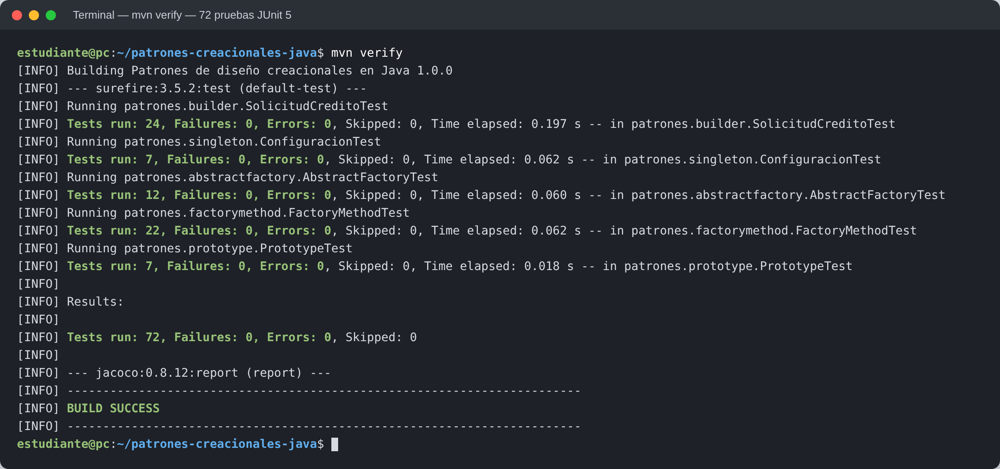
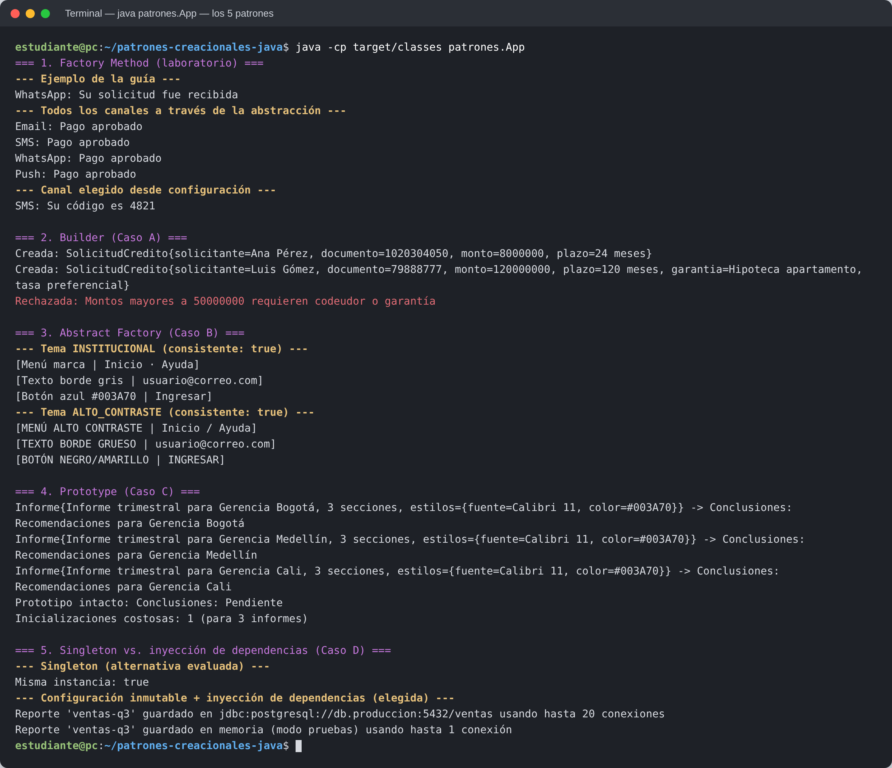
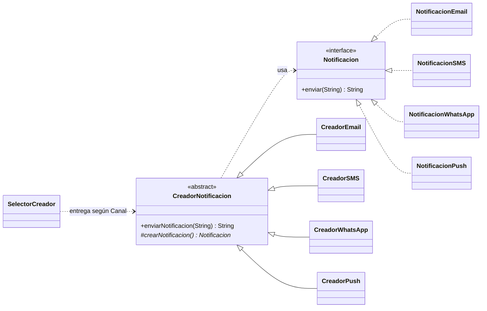
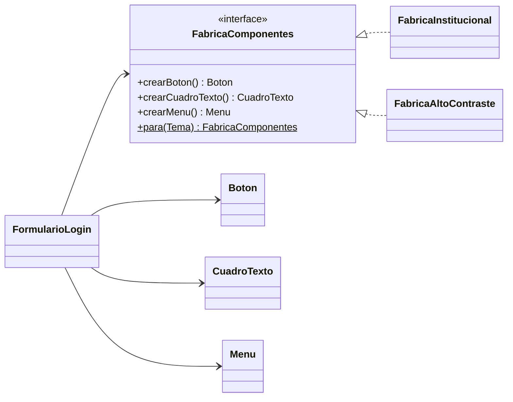
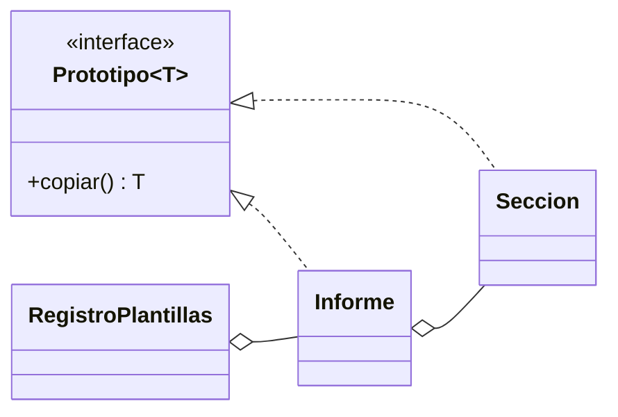

# Patrones de diseño creacionales en Java

[](https://github.com/SrDiego18/patrones-creacionales-java/actions/workflows/ci-pages.yml)


**Integrantes:** Diego Romero · Maicol Rubiano · Camilo Bastidas · Santiago Solano

**🌐 Demo en vivo: https://srdiego18.github.io/patrones-creacionales-java/**

Solución de la guía *Patrones de diseño creacionales en Java* (Patrones y metodologías de desarrollo).
La guía pide implementar **dos** patrones en el trabajo autónomo; aquí están los **cinco** patrones GoF,
cada uno ligado a un caso de la guía, con pruebas automáticas y una página web interactiva.

| Patrón | Caso de la guía | Paquete | Qué demuestra |
|---|---|---|---|
| Factory Method | Laboratorio (sección 6) | [`factorymethod`](src/main/java/patrones/factorymethod) | Refactorización del servicio de notificaciones: Email, SMS, WhatsApp y Push sin modificar la clase base |
| Builder | Caso A — Solicitud de crédito | [`builder`](src/main/java/patrones/builder) | Obligatorios y opcionales, validación de combinaciones en `build()`, objeto inmutable |
| Abstract Factory | Caso B — Interfaz por marca | [`abstractfactory`](src/main/java/patrones/abstractfactory) | Familias de componentes (tema institucional y alto contraste) que nunca se mezclan |
| Prototype | Caso C — Plantillas de informes | [`prototype`](src/main/java/patrones/prototype) | Inicialización costosa una sola vez, copia profunda, registro de prototipos |
| Singleton vs. DI | Caso D — Configuración global | [`singleton`](src/main/java/patrones/singleton) | Singleton con `enum` frente a configuración inmutable inyectada (la opción elegida) |

La guía resuelta, con todas las respuestas, está en [`docs/`](docs).

## Cómo ejecutar

Requisitos: Java 17 o superior y Maven 3.8 o superior.

```bash
mvn verify                                  # compila, ejecuta las pruebas y genera la cobertura
java -cp target/classes patrones.App        # ejecuta las demostraciones de los 5 patrones
```

- Reporte de pruebas: `target/surefire-reports/`
- Reporte de cobertura: `target/site/jacoco/index.html`

Sin Maven, solo el código principal:

```bash
javac -d out $(find src/main -name "*.java")
java -cp out patrones.App
```

## Capturas de ejecución

**Pruebas (`mvn verify`, ejecución real en GitHub Actions):**



**Demostraciones de los cinco patrones (`java -cp target/classes patrones.App`):**



## Diseño

### Factory Method (laboratorio)



- `enviarNotificacion` es `final`: una prueba verifica que ningún canal nuevo la puede modificar.
- Agregar un canal = `NotificacionX` + `CreadorX` + una línea en `SelectorCreador`. Ninguna clase existente cambia.
- **Más allá de la guía:** la guía observa que *"el código cliente aún selecciona el creador concreto"*. `SelectorCreador` y el enum `Canal` lo resuelven: el cliente pide `Canal.SMS` y nunca menciona clases concretas.
- El código original se conserva en [`antes/ServicioNotificacionesOriginal`](src/main/java/patrones/factorymethod/antes/ServicioNotificacionesOriginal.java) para comparar.

### Builder (Caso A)

```mermaid
classDiagram
    direction LR
    class SolicitudCredito{
        -String solicitante
        -String documento
        -BigDecimal monto
        -int plazoMeses
        -String codeudor
        -String garantia
        +builder(...)$ Builder
    }
    class Builder{
        +codeudor(String) Builder
        +garantia(String) Builder
        +descripcion(String) Builder
        +tasaPreferencial(boolean) Builder
        +build() SolicitudCredito
    }
    SolicitudCredito +-- Builder
```

Reglas validadas en `build()`: documento de 6 a 12 dígitos; monto entre 500 000 y 500 000 000; plazo de 6 a 120 meses;
más de 50 000 000 exige codeudor o garantía; la tasa preferencial solo aplica con garantía.
*Alternativa descartada:* un constructor de 8 parámetros (fácil confundir el orden) y los *setters* JavaBeans (permiten estados inválidos).

### Abstract Factory (Caso B)



Un tema nuevo requiere solo una fábrica nueva. Su limitación: un *tipo* de componente nuevo obliga a modificar todas las fábricas.

### Prototype (Caso C)



Se usa un constructor de copia en lugar de `clone()` (Bloch, Item 13). La copia es **profunda**: las pruebas verifican
que modificar una copia no altera el prototipo (pregunta 10 de la guía) y que la inicialización costosa ocurre una sola vez.

### Singleton vs. inyección de dependencias (Caso D)

Se evaluó Singleton, implementado como `enum` (thread-safe, Bloch Item 3), pero se eligió `Configuracion`: un `record`
inmutable y validado que se crea una vez y se **inyecta por constructor**. Sigue habiendo un solo objeto, pero sin
estado global ni dependencias ocultas, y en las pruebas se puede pasar otra configuración (pregunta 11).

## Pruebas

Las pruebas usan JUnit 5 (`@DisplayName` en español, pruebas parametrizadas) y se ejecutan en GitHub Actions con cada
cambio. La página web muestra los resultados y la cobertura de la última ejecución.

| Clase de prueba | Qué cubre |
|---|---|
| `FactoryMethodTest` | Los 4 escenarios de la sección 6.3, método `final`, selector, validación de mensajes y canales |
| `SolicitudCreditoTest` | Escenarios válidos e inválidos, valores límite, `equals`/`hashCode` |
| `AbstractFactoryTest` | Coherencia de cada familia, mismo cliente con distintas fábricas, temas inválidos |
| `PrototypeTest` | Copia profunda, copia defensiva, inicialización única, vistas inmutables |
| `ConfiguracionTest` | Singleton desde 100 tareas concurrentes, inyección en pruebas, validación |

## Correspondencia con la rúbrica

| Criterio de la guía | Dónde se cumple |
|---|---|
| Análisis del problema y selección (25 %) | Secciones *Diseño* y página web; cada patrón con problema, restricciones y alternativa descartada |
| Implementación funcional (30 %) | 5 patrones en `src/main/java`, demos en `patrones.App` y en la web |
| Calidad del diseño (20 %) | Responsabilidades separadas, inmutabilidad, validación, sin advertencias del compilador (`-Xlint:all` con `failOnWarning`) |
| Pruebas (15 %) | Pruebas JUnit 5 por patrón (se piden mínimo 3), CI en cada cambio, cobertura con JaCoCo |
| Reflexión crítica (10 %) | Costos y limitaciones de cada patrón en este README y en la guía resuelta |

## Estructura

```
src/main/java/patrones/
├── App.java                       # ejecuta las 5 demostraciones
├── factorymethod/  builder/  abstractfactory/  prototype/  singleton/
src/test/java/patrones/            # pruebas JUnit 5
web/index.html                     # página interactiva (se publica con GitHub Pages)
.github/workflows/ci-pages.yml     # compila, prueba y publica la web
docs/                              # guía resuelta (.docx)
```

## Referencias

- Bloch, J. (2018). *Effective Java* (3rd ed.). Addison-Wesley.
- Freeman, E., Robson, E., Bates, B., & Sierra, K. (2004). *Head First Design Patterns*. O'Reilly Media.
- Gamma, E., Helm, R., Johnson, R., & Vlissides, J. (1994). *Design Patterns: Elements of Reusable Object-Oriented Software*. Addison-Wesley.
